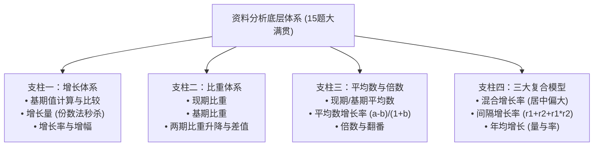

# 资料分析 · 全景贯通与终极秒杀速查宝典

> **作战目标**：行测 15 道资料分析，20~22 分钟内完成，目标正确率 **90%+（保 13 争 15）**。  
> 资料分析绝不是算术考试，而是**公式条件反射 + 选项敏感度 + 命题人逻辑解构**。

---

## 🗺️ 第一部分：资料分析全景逻辑图谱

整个资料分析的底层只有 **4 个基本量**：
- **现期值 ($A$)**、**基期值 ($B$)**、**增长量 ($x$)**、**增长率 ($r$)**
$$x = A - B, \quad r = \frac{x}{B} = \frac{A - B}{B}, \quad A = B \times (1 + r), \quad B = \frac{A}{1 + r}$$

命题人的一切考题变形，都是基于这 4 个量演化出的**四大考查支柱**：

---

## 🏛️ 第二部分：四大支柱核心公式与秒杀绝技

### 支柱一：增长体系（基本功）

#### 1. 基期值计算
- **核心公式**：$B = \frac{A}{1+r}$
- **速算秘诀**：
  - 若 $|r| \le 5\%$（微小增长率）：**化除为乘** $\Rightarrow B \approx A \times (1 - r)$
  - 若 $r$ 较大：分母从左往右四舍五入截前三位，直除看首一两位锁定选项。

#### 2. 增长量（考场最高频）
- **公式**：$\text{增长量} = A - \frac{A}{1+r} = \frac{A \times r}{1+r}$
- **秒杀绝技（百化分份数法）**：将增长率 $r$ 转化为分数 $\frac{1}{n}$
  - **增长（$r > 0$）**：$\text{增长量} = \frac{A}{n + 1}$
  - **下降（$r < 0$）**：$\text{减少量} = \frac{A}{n - 1}$
- **增长量比较大小口诀**：
  - **大大则大**：现期量大且增长率也大的，增长量必然最大；
  - **一大一小看乘积**：现期量与增长率一高一低，估算 $A \times r$ 的乘积，乘积明显大的增长量大。

---

### 支柱二：比重体系（四川省考必考题）

设部分量为 $A$（对应增长率 $a$），整体量为 $B$（对应增长率 $b$）：

#### 1. 现期比重 vs 基期比重
- **现期比重**：$\frac{A}{B}$
- **基期比重**：$\frac{A}{B} \times \frac{1+b}{1+a}$
  - *实战提速*：先算出或观察现期比重 $\frac{A}{B}$，再用 $\frac{1+b}{1+a}$ 判定基期是略大还是略小，无需死算乘除。

#### 2. 两期比重变化（10秒秒杀题）
- **第一步：定升降（看 $a$ 与 $b$）**
  - 部分增速 $a >$ 整体增速 $b \Rightarrow$ 比重**上升**
  - 部分增速 $a <$ 整体增速 $b \Rightarrow$ 比重**下降**
- **第二步：定数值（找绝对值小于 $|a - b|$ 的选项）**
  - 两期比重差 $= \frac{A}{B} \times \frac{a - b}{1 + a}$
  - 因为 $\frac{A}{B} < 1$，且分母 $1+a > 0$，所以：
  $$\text{两期比重差} < |a - b|$$
  - **实战法则**：排除升降相反的选项，直接在剩下选项中挑选**小于 $|a - b|$** 的选项，通常直接秒杀唯一答案。

---

### 支柱三：平均数与倍数体系

平均数与倍数的本质，与比重完全一致（都是 $\frac{A}{B}$ 的形式）：

#### 1. 识别“谁是分子，谁是分母”
- **口诀**：**“每”后面、“后”面的是分母**。
  - 例：人均国内生产总值 = $\frac{\text{国内生产总值}}{\text{总人口}}$；单位面积产量 = $\frac{\text{总产量}}{\text{总播种面积}}$。
- **倍数关系**：
  - A 是 B 的多少倍 $\Rightarrow \frac{A}{B}$
  - A 比 B 多多少倍 $\Rightarrow \frac{A - B}{B} = \frac{A}{B} - 1$
  - 翻 $k$ 番 $\Rightarrow$ 变为原来的 $2^k$ 倍。

#### 2. 平均数增长率（公式之王）
- **题型标志**：“……的平均……比上年增长/下降了百分之几？”
- **公式**：
  $$r_{\text{平均}} = \frac{a - b}{1 + b}$$
  （其中 $a$ 为分子增长率，$b$ 为分母增长率）

---

### 支柱四：三大高级复合模型

#### 1. 间隔增长率（隔一年增长）
- **题型标志**：“2024 年比 2022 年增长了百分之几？”（中间隔了 2023 年）
- **公式**：
  $$r_{\text{间隔}} = r_1 + r_2 + r_1 \times r_2$$
- **算力技巧**：绝大多数题目中，$r_1 + r_2$ 的数值已经足够锁定唯一答案；若两个选项极为接近，再补算 $r_1 \times r_2$。

#### 2. 混合增长率（整体与部分）
- **常见场景**：
  - 进出口总额 = 进口额 + 出口额
  - 上半年 = 一季度 + 二季度
  - 工业总产值 = 轻工业 + 重工业
  - 全省经济 = 成都市 + 其它市州
- **三大秒杀口诀**：
  1. **居中**：混合增长率介于各部分增长率之间（小 $<$ 混合 $<$ 大）；
  2. **偏大**：混合增长率一定**偏向基期量（现期量近似代替）更大**的一方；
  3. **十字交叉 / 线段法**：距离比与基期量（现期量）成反比：
  $$\frac{r_{\text{大}} - r_{\text{混}}}{r_{\text{混}} - r_{\text{小}}} = \frac{\text{基期量}_{\text{小}}}{\text{基期量}_{\text{大}}}$$

#### 3. 年均增长（防坑要地）
- **年份差 $n$**：末期年份 $-$ 初期年份（例如 2020~2025 年，$n = 2025 - 2020 = 5$）。
  > [!WARNING] **规划类陷阱**
  > 若题目考查“**‘十四五’时期**（2021—2025年）年均增长……”，基期必须往前推一年，取 **2020 年**！$n = 2025 - 2020 = 5$。
- **年均增长量**：
  $$\text{年均增长量} = \frac{\text{末期量} - \text{初期量}}{n}$$
- **年均增长率**：
  $$(1 + r)^n = \frac{\text{末期量}}{\text{初期量}}$$
  - **实战估算技巧**：通常无需硬开方，优先代入选项验证；或用 $(1 + n \cdot r) \approx \frac{\text{末期量}}{\text{初期量}}$ 进行估算判断区间。

---

## ⚔️ 第三部分：考场三大速算利刃

真正进考场，绝不列复杂长乘除竖式，靠这三把利刃解决 95% 的计算：

### 1. 截位直除法
- **原则**：**分子基本不动，分母从左往右截位**。
- **截位准则**：
  - 选项首位不同 / 差距很大（$>10\%$）：分母四舍五入**截前两位**；
  - 选项首位相同第二位不同 / 差距小（$<10\%$）：分母四舍五入**截前三位**；
  - 直除看商的首一到两位，能区分选项即停笔！

### 2. 百化分速算金字塔（必背反射表）
看到以下百分数，必须像数字一样形成条件反射：

| 百分数 | 对应分数 | 增长量计算（上升） | 增长量计算（下降） |
| :---: | :---: | :---: | :---: |
| **50.0%** | $\frac{1}{2}$ | $\div 3$ | $\div 1$ |
| **33.3%** | $\frac{1}{3}$ | $\div 4$ | $\div 2$ |
| **25.0%** | $\frac{1}{4}$ | $\div 5$ | $\div 3$ |
| **20.0%** | $\frac{1}{5}$ | $\div 6$ | $\div 4$ |
| **16.7%** | $\frac{1}{6}$ | $\div 7$ | $\div 5$ |
| **14.3%** | $\frac{1}{7}$ | $\div 8$ | $\div 6$ |
| **12.5%** | $\frac{1}{8}$ | $\div 9$ | $\div 7$ |
| **11.1%** | $\frac{1}{9}$ | $\div 10$ | $\div 8$ |
| **9.1%** | $\frac{1}{11}$ | $\div 12$ | $\div 10$ |
| **8.3%** | $\frac{1}{12}$ | $\div 13$ | $\div 11$ |
| **7.7%** | $\frac{1}{13}$ | $\div 14$ | $\div 12$ |
| **7.1%** | $\frac{1}{14}$ | $\div 15$ | $\div 13$ |
| **6.7%** | $\frac{1}{15}$ | $\div 16$ | $\div 14$ |
| **6.25%** | $\frac{1}{16}$ | $\div 17$ | $\div 15$ |

### 3. 分数大小比较三阶法
1. **看分子分母**：一大一小直接定胜负（分子大分母小的分数大）；
2. **看倍数/增速**：分子增长倍数明显大于分母增长倍数，该分数变大；
3. **差分法**：大分数分子减小分数分子、大分母减小分母组成“差分数”，拿“差分数”代替大分数跟小分数比。

---

## 🛡️ 第四部分：考场四大致命陷阱（避坑清单）

| 陷阱类型 | 命题人常见挖坑手法 | 避坑口诀 |
| :--- | :--- | :--- |
| **时间陷阱** | 问 2024 年，给的是 2025 年；问“1~8月”，给的是“8月当月”或累积数据 | **做题先圈定时间** |
| **主体陷阱** | 材料是“进出口总额”，问的是“出口额”；材料是“工业”，问“规模以上工业” | **题干核心主语划波浪线** |
| **单位陷阱** | “亿元”与“万元”、“吨”与“千克”、“百分数（%）”与“百分点” | **看清单位转换，量级先对齐** |
| **顺逆差陷阱**| 进出口中：顺差 = 出口 $-$ 进口；逆差 = 进口 $-$ 出口 | **出大于进为顺，进大于出为逆** |
